# The CMS’s schema

> Generated by `pnpm cms:schema` from the built configuration (CMS-280) — never edited by hand.
> `pnpm migrate:create` writes it again, and a test fails when it lags behind the configuration. Each field: its
> kind, its French name, « requis » when required, « traduit » when translated — the fields Payload adds itself
> (its dates, the bin’s) included. A relation reads « the collection on the left cites the one on the right »;
> many (`}o--o{`) for a field of many values or one inside a list. Not drawn: the MCP plugin’s keys, Payload’s own
> collections, and the tables it lays under them (`_locales`, `_rels`).

```mermaid
erDiagram
  events["Événement"] {
    text title "Titre · requis · traduit"
    relationship type "Type · requis"
    group date "Date"
    group date_start "Début"
    number date_start_year "Année · requis"
    number date_start_month "Mois"
    number date_start_day "Jour"
    checkbox date_start_circa "Vers (année estimée)"
    number date_start_margin "Marge (± ans)"
    select date_start_calendar "Calendrier du jour"
    group date_end "Fin"
    number date_end_year "Année"
    number date_end_month "Mois"
    number date_end_day "Jour"
    checkbox date_end_circa "Vers (année estimée)"
    number date_end_margin "Marge (± ans)"
    select date_end_calendar "Calendrier du jour"
    relationship place "Lieu"
    relationship actors "Acteurs"
    textarea description "Description · traduit"
    relationship sources "Sources"
    text wikidata "Wikidata"
    date updatedAt "updatedAt"
    date createdAt "createdAt"
  }
  event_types["Type d’événement"] {
    text name "Nom · requis"
    array otherNames "Le nom dans les autres langues"
    select otherNames_language "Langue · requis"
    text otherNames_form "Nom · requis"
    text otherNames_id "ID"
    select icon "Icône sur la carte · requis"
    select colour "Couleur de l’épingle · requis"
    date updatedAt "updatedAt"
    date createdAt "createdAt"
  }
  siege_engines["Engin de siège"] {
    text name "Nom · requis"
    array otherNames "Le nom dans les autres langues"
    select otherNames_language "Langue · requis"
    text otherNames_form "Nom · requis"
    text otherNames_id "ID"
    select engine "Dessin sur la carte · requis"
    group inUse "En usage"
    group inUse_start "Début"
    number inUse_start_year "Année · requis"
    number inUse_start_month "Mois"
    number inUse_start_day "Jour"
    checkbox inUse_start_circa "Vers (année estimée)"
    number inUse_start_margin "Marge (± ans)"
    select inUse_start_calendar "Calendrier du jour"
    group inUse_end "Fin"
    number inUse_end_year "Année"
    number inUse_end_month "Mois"
    number inUse_end_day "Jour"
    checkbox inUse_end_circa "Vers (année estimée)"
    number inUse_end_margin "Marge (± ans)"
    select inUse_end_calendar "Calendrier du jour"
    relationship sources "Sources · requis"
    text wikidata "Wikidata"
    date updatedAt "updatedAt"
    date createdAt "createdAt"
  }
  places["Lieu"] {
    text name "Nom · requis"
    array otherNames "Le nom dans les autres langues"
    select otherNames_language "Langue · requis"
    text otherNames_form "Nom · requis"
    text otherNames_id "ID"
    point location "Position (longitude, latitude) · requis"
    text wikidata "Wikidata"
    group country "Pays aujourd’hui"
    text country_name "Nom"
    text country_wikidata "Wikidata"
    group region "Région aujourd’hui"
    text region_name "Nom"
    text region_wikidata "Wikidata"
    group existsFrom "Existe depuis"
    number existsFrom_year "Année"
    number existsFrom_month "Mois"
    number existsFrom_day "Jour"
    checkbox existsFrom_circa "Vers (année estimée)"
    number existsFrom_margin "Marge (± ans)"
    select existsFrom_calendar "Calendrier du jour"
    group existsTo "Existe jusqu’à"
    number existsTo_year "Année"
    number existsTo_month "Mois"
    number existsTo_day "Jour"
    checkbox existsTo_circa "Vers (année estimée)"
    number existsTo_margin "Marge (± ans)"
    select existsTo_calendar "Calendrier du jour"
    date updatedAt "updatedAt"
    date createdAt "createdAt"
    date deletedAt "deletedAt"
  }
  place_periods["Ville à une date"] {
    text title "Titre"
    relationship place "Lieu · requis"
    relationship periodName "Nom d’époque"
    group date "Date"
    group date_start "Début"
    number date_start_year "Année · requis"
    number date_start_month "Mois"
    number date_start_day "Jour"
    checkbox date_start_circa "Vers (année estimée)"
    number date_start_margin "Marge (± ans)"
    select date_start_calendar "Calendrier du jour"
    group date_end "Fin"
    number date_end_year "Année"
    number date_end_month "Mois"
    number date_end_day "Jour"
    checkbox date_end_circa "Vers (année estimée)"
    number date_end_margin "Marge (± ans)"
    select date_end_calendar "Calendrier du jour"
    select importance "Importance · requis"
    checkbox showInAtlas "Afficher la ville dans l’atlas"
    relationship reasons "Raisons"
    relationship holderTitle "Détenteur"
    text holderName "Tenue par"
    text holderQid "Identifiant Wikidata du pays"
    array communities "Communautés religieuses"
    relationship communities_confession "Confession · requis"
    select communities_weight "Poids · requis"
    checkbox communities_weightAttested "Poids attesté par une source"
    text communities_id "ID"
    array testimonies "Ce que disent les sources"
    relationship testimonies_source "Source · requis"
    select testimonies_subject "Sur quoi · requis"
    number testimonies_population "Habitants · requis"
    select testimonies_importance "Importance · requis"
    relationship testimonies_reason "Raison · requis"
    text testimonies_holderName "Pays · requis"
    text testimonies_holderQid "Identifiant Wikidata du pays"
    checkbox testimonies_byDistrict "Déduite de son district"
    text testimonies_holderAsWritten "Nom dans la source"
    relationship testimonies_confession "Confession · requis"
    text testimonies_where "Où"
    textarea testimonies_quotation "Citation"
    text testimonies_id "ID"
    date updatedAt "updatedAt"
    date createdAt "createdAt"
    date deletedAt "deletedAt"
  }
  period_names["Nom d’époque"] {
    text label "Nom d’époque"
    relationship place "Lieu · requis"
    array forms "Le nom dans chaque langue · requis"
    select forms_language "Langue · requis"
    text forms_form "Nom · requis"
    text forms_id "ID"
    array lines "Ce que disent les sources"
    relationship lines_source "Source · requis"
    text lines_where "Où"
    textarea lines_quotation "Citation"
    text lines_asWritten "Nom dans la source"
    text lines_id "ID"
    date updatedAt "updatedAt"
    date createdAt "createdAt"
    date deletedAt "deletedAt"
  }
  importance_reasons["Raison d’importance"] {
    text name "Nom · requis"
    array otherNames "Le nom dans les autres langues"
    select otherNames_language "Langue · requis"
    text otherNames_form "Nom · requis"
    text otherNames_id "ID"
    date updatedAt "updatedAt"
    date createdAt "createdAt"
    date deletedAt "deletedAt"
  }
  confessions["Confession"] {
    text name "Nom · requis"
    array otherNames "Le nom dans les autres langues"
    select otherNames_language "Langue · requis"
    text otherNames_form "Nom · requis"
    text otherNames_id "ID"
    date updatedAt "updatedAt"
    date createdAt "createdAt"
    date deletedAt "deletedAt"
  }
  people["Personne"] {
    text name "Nom · requis"
    array otherNames "Le nom dans les autres langues"
    select otherNames_language "Langue · requis"
    text otherNames_form "Nom · requis"
    text otherNames_id "ID"
    select kind "Personne ou maison · requis"
    text wikidata "Wikidata"
    group born "Naissance"
    number born_year "Année"
    number born_month "Mois"
    number born_day "Jour"
    checkbox born_circa "Vers (année estimée)"
    number born_margin "Marge (± ans)"
    select born_calendar "Calendrier du jour"
    group died "Mort"
    number died_year "Année"
    number died_month "Mois"
    number died_day "Jour"
    checkbox died_circa "Vers (année estimée)"
    number died_margin "Marge (± ans)"
    select died_calendar "Calendrier du jour"
    group founded "Fondation"
    number founded_year "Année"
    number founded_month "Mois"
    number founded_day "Jour"
    checkbox founded_circa "Vers (année estimée)"
    number founded_margin "Marge (± ans)"
    select founded_calendar "Calendrier du jour"
    group ended "Extinction"
    number ended_year "Année"
    number ended_month "Mois"
    number ended_day "Jour"
    checkbox ended_circa "Vers (année estimée)"
    number ended_margin "Marge (± ans)"
    select ended_calendar "Calendrier du jour"
    relationship house "Maison"
    relationship father "Père"
    relationship mother "Mère"
    relationship founder "Fondateur"
    date updatedAt "updatedAt"
    date createdAt "createdAt"
    date deletedAt "deletedAt"
  }
  territories["Territoire"] {
    text name "Nom · requis"
    select kind "Sorte · requis"
    array otherNames "Le nom dans les autres langues"
    select otherNames_language "Langue · requis"
    text otherNames_form "Nom · requis"
    text otherNames_id "ID"
    text wikidata "Wikidata"
    group existsFrom "Existe depuis"
    number existsFrom_year "Année"
    number existsFrom_month "Mois"
    number existsFrom_day "Jour"
    checkbox existsFrom_circa "Vers (année estimée)"
    number existsFrom_margin "Marge (± ans)"
    select existsFrom_calendar "Calendrier du jour"
    group existsTo "Existe jusqu’à"
    number existsTo_year "Année"
    number existsTo_month "Mois"
    number existsTo_day "Jour"
    checkbox existsTo_circa "Vers (année estimée)"
    number existsTo_margin "Marge (± ans)"
    select existsTo_calendar "Calendrier du jour"
    date updatedAt "updatedAt"
    date createdAt "createdAt"
    date deletedAt "deletedAt"
  }
  titles["Titre"] {
    text label "Titre"
    relationship person "Personne · requis"
    relationship territory "Territoire · requis"
    group date "Date"
    group date_start "Début"
    number date_start_year "Année · requis"
    number date_start_month "Mois"
    number date_start_day "Jour"
    checkbox date_start_circa "Vers (année estimée)"
    number date_start_margin "Marge (± ans)"
    select date_start_calendar "Calendrier du jour"
    group date_end "Fin"
    number date_end_year "Année"
    number date_end_month "Mois"
    number date_end_day "Jour"
    checkbox date_end_circa "Vers (année estimée)"
    number date_end_margin "Marge (± ans)"
    select date_end_calendar "Calendrier du jour"
    checkbox sovereign "Souverain"
    array lines "Ce que disent les sources"
    relationship lines_source "Source · requis"
    text lines_where "Où"
    textarea lines_quotation "Citation"
    text lines_asWritten "Nom dans la source"
    text lines_id "ID"
    date updatedAt "updatedAt"
    date createdAt "createdAt"
    date deletedAt "deletedAt"
  }
  hierarchy_links["Maillon"] {
    text label "Maillon"
    relationship vassal "Vassal · requis"
    radio answersTo "Relève de · requis"
    relationship suzerain "Suzerain"
    group date "Date"
    group date_start "Début"
    number date_start_year "Année · requis"
    number date_start_month "Mois"
    number date_start_day "Jour"
    checkbox date_start_circa "Vers (année estimée)"
    number date_start_margin "Marge (± ans)"
    select date_start_calendar "Calendrier du jour"
    group date_end "Fin"
    number date_end_year "Année"
    number date_end_month "Mois"
    number date_end_day "Jour"
    checkbox date_end_circa "Vers (année estimée)"
    number date_end_margin "Marge (± ans)"
    select date_end_calendar "Calendrier du jour"
    array lines "Ce que disent les sources"
    relationship lines_source "Source · requis"
    text lines_where "Où"
    textarea lines_quotation "Citation"
    text lines_asWritten "Nom dans la source"
    text lines_id "ID"
    date updatedAt "updatedAt"
    date createdAt "createdAt"
    date deletedAt "deletedAt"
  }
  sources["Source"] {
    text title "Titre · requis"
    text author "Auteur"
    text publisher "Éditeur"
    number editionYear "Année d’édition"
    select kind "Genre"
    select licence "Licence"
    text url "Adresse en ligne"
    relationship copyOf "Copie de"
    date updatedAt "updatedAt"
    date createdAt "createdAt"
    date deletedAt "deletedAt"
  }
  users["Contributeur"] {
    date updatedAt "updatedAt"
    date createdAt "createdAt"
    email email "email · requis"
    text resetPasswordToken "resetPasswordToken"
    date resetPasswordExpiration "resetPasswordExpiration"
    text salt "salt"
    text hash "hash"
    date resetPasswordRequestedAt "resetPasswordRequestedAt"
    number loginAttempts "loginAttempts"
    date lockUntil "lockUntil"
    array sessions "sessions"
    text sessions_id "id · requis"
    date sessions_createdAt "createdAt"
    date sessions_expiresAt "expiresAt · requis"
  }
  events }o--|| event_types : "type"
  events }o--o| places : "place"
  events }o--o{ people : "actors"
  events }o--o{ sources : "sources"
  siege_engines }o--o{ sources : "sources"
  place_periods }o--|| places : "place"
  place_periods }o--o| period_names : "periodName"
  place_periods }o--o{ importance_reasons : "reasons"
  place_periods }o--o| titles : "holderTitle"
  place_periods }o--o{ confessions : "communities.confession"
  place_periods }o--o{ sources : "testimonies.source"
  place_periods }o--o{ importance_reasons : "testimonies.reason"
  place_periods }o--o{ confessions : "testimonies.confession"
  period_names }o--|| places : "place"
  period_names }o--o{ sources : "lines.source"
  people }o--o| people : "house"
  people }o--o| people : "father"
  people }o--o| people : "mother"
  people }o--o| people : "founder"
  titles }o--|| people : "person"
  titles }o--|| territories : "territory"
  titles }o--o{ sources : "lines.source"
  hierarchy_links }o--|| titles : "vassal"
  hierarchy_links }o--o| titles : "suzerain"
  hierarchy_links }o--o{ sources : "lines.source"
  sources }o--o{ sources : "copyOf"
```

